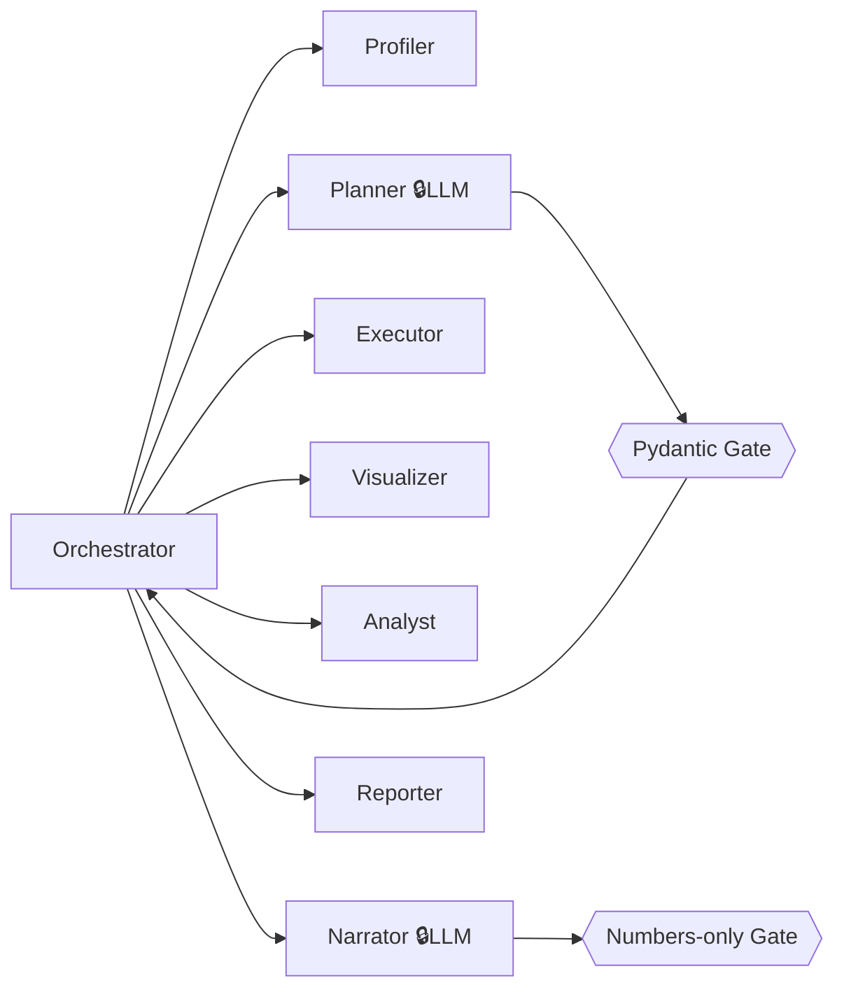

# Agents — AI Data Science Agent

> **Status:** Draft v0.1 · **Traces to:** PRD §5, §6, §10 · **Note:** these are the *product's* internal agents, not AI coding assistants.

## 1. Agent Model

The system is composed of one **Orchestrator** and six specialist agents. Only two
agents use the LLM (Planner, Narrator); the rest are deterministic code. Every LLM
output passes through a code-owned gate before anything else sees it.

| Agent | Type | LLM? | PRD |
|---|---|---|---|
| Orchestrator | deterministic | no | §8 job handling |
| Profiler | deterministic | no | §6.2 |
| Planner | **LLM** | yes | §6.3 |
| Executor | deterministic | no | §6.5 |
| Visualizer | deterministic | no | §6.6 |
| Analyst | deterministic | no | §6.7 |
| Narrator | **LLM** | yes | §6.7, §6.8 |
| Reporter | deterministic | no | §6.8, §6.9 |

## 2. Orchestrator

- **Purpose:** owns the session state machine; runs each stage as a background task;
  records progress for UI polling; records stage errors without losing prior artifacts.
- **Inputs:** stage requests from routers. **Outputs:** state transitions, structured logs.
- **Failure behavior:** a failed stage leaves the session in its last good state with a
  recorded error; stages are individually retryable (see `architecture.md` §4).

## 3. Profiler Agent *(deterministic — PRD §6.2)*

- **Input:** raw upload CSV. **Output:** compact profile JSON.
- **Does:** encoding detection + delimiter sniffing (with ingestion); per-column type
  inference into exactly one of `numeric | categorical | datetime | boolean | text | id_like`;
  null counts/%, duplicate-row count, unique counts, top values; IQR outlier detection
  (method recorded in the profile); emits a compact JSON profile sized for an LLM prompt.
- **Guardrails:** never sends data anywhere; never mutates the upload.
- **Failure:** unreadable file → session error at `uploaded` with a specific reason.

## 4. Planner Agent *(LLM — PRD §6.3)*

- **Input:** the profile JSON **only** — no raw rows ever.
- **Output:** `{"schema":"v1","steps":[{op, column, params, rationale}, …]}` — validated
  by the Pydantic Gate against the whitelist (`drop_duplicates`, `drop_column`, `impute`,
  `clip_outliers`, `cast_type`, `parse_datetime`, `standardize_text`).
- **Guardrails:** whitelist + schema validation; unknown ops/params/columns rejected;
  invalid output re-prompts with the validation error, **bounded retries** (default 3);
  temperature low, seed pinned when supported.
- **Failure:** after retries → plan-generation failure; user can retry. Never falls back
  to "just apply something".
- **Cannot:** execute anything, modify data, or see raw values beyond profile aggregates.

## 5. Executor Agent *(deterministic — PRD §6.5)*

- **Input:** upload CSV + **approved** plan steps only (a plan without approval never
  reaches this agent — enforced by the Orchestrator's state machine).
- **Output:** cleaned CSV artifact + execution log (per step: op, params, rows/cols/nulls
  before vs after).
- **Does:** applies steps in order via pandas; dry-run validates `cast_type` before
  mutating; preserves original column names/order unless an approved drop/rename applies;
  original upload untouched.
- **Failure:** a failing step aborts execution, keeps the completed-steps log, marks the
  session error for plan editing and retry.

## 6. Visualizer Agent *(deterministic — PRD §6.6)*

- **Input:** cleaned CSV + profile. **Output:** capped set of chart PNGs.
- **Does:** histograms + box plots (numeric), top-category bars (categorical),
  correlation heatmap (≥2 numeric), missing-value map (any nulls); caps total charts
  (default 12) with a documented priority order.
- **Failure:** skips ineligible chart types; never blocks the pipeline.

## 7. Analyst Agent *(deterministic — PRD §6.7)*

- **Input:** cleaned CSV + user-confirmed target column.
- **Output:** problem type + per-model CV results (`model_runs`).
- **Does:** rule-based problem detection (dtype + cardinality; ID-like targets rejected);
  trains 2–3 baselines (e.g., logistic/linear regression, random forest, plus a dummy
  floor) with proper splits and fixed-seed cross-validation; all preprocessing
  (imputers/encoders/scalers) fit **on training data only** inside sklearn Pipelines —
  leakage is structurally prevented (PRD §10).
- **Failure:** invalid target rejected before any training, with an explanation.

## 8. Narrator Agent *(LLM — PRD §6.7, §6.8)*

- **Input:** **computed numbers only** — profile issue summary, execution-log deltas,
  model comparison table. No raw data, no free rein over numbers.
- **Output:** plain-language findings and a model recommendation that stays within what
  the numbers support; baselines are described as baselines, never as
  production-ready models (PRD §3).
- **Guardrails:** numbers in the report are inserted by the Reporter from stored
  artifacts, never generated by the LLM (anti-hallucination, PRD §10 Risk 4).
- **Failure:** falls back to a deterministic template summary so the report is still
  complete.

## 9. Reporter Agent *(deterministic — PRD §6.8–6.9)*

- **Input:** all session artifacts + narration text.
- **Output:** `report.html` with ordered sections (snapshot → issues → plan & approvals →
  before/after → charts → ML analysis → narrated summary) and, with the Executor's CSV,
  the two required deliverables. Original column names/order preserved.
- **Failure:** renders with the missing section listed rather than failing the session.

## 10. Communication Contracts (summary)

| From → To | Payload | Schema owner |
|---|---|---|
| Profiler → Planner | `profile.json` (compact, typed) | `schemas/profile.py` |
| Planner → Gate → UI | `plan.json` (`schema: v1`) | `schemas/plan.py` (whitelist) |
| UI → Orchestrator | approved/edited steps | `schemas/plan.py` |
| Executor → Reporter/Narrator | `execution_log.json` (before/after) | `schemas/execution.py` |
| Analyst → Narrator | `model_runs.json` (CV metrics) | `schemas/models.py` |
| Narrator → Reporter | `narration.json` (text sections) | `schemas/narration.py` |

All inter-agent communication is via stored JSON artifacts, never in-memory only —
this is what makes sessions resumable, auditable, and reproducible.

## 11. Future Agents (stretch — PRD §12)

- **Follow-up chat agent** — answers "why did you drop this column?" grounded in the
  session's artifacts (same numbers-only rule)
- **Script-export agent** — emits the reproducible Python script of executed steps
  (deterministic templating, not LLM codegen)

Both reuse the existing artifact contracts; no new data paths.
