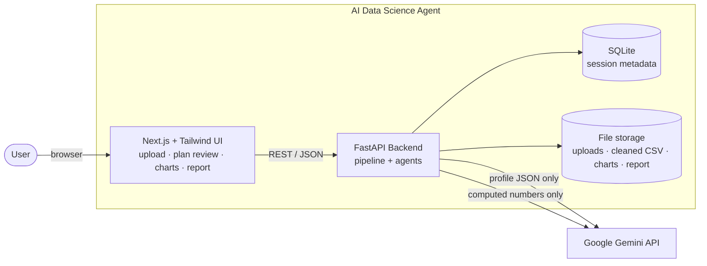
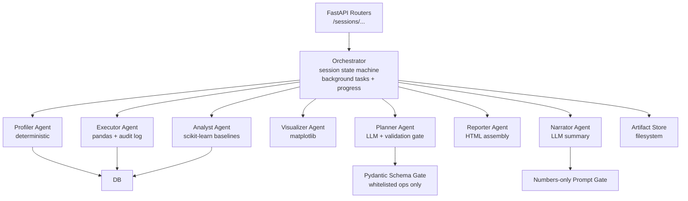
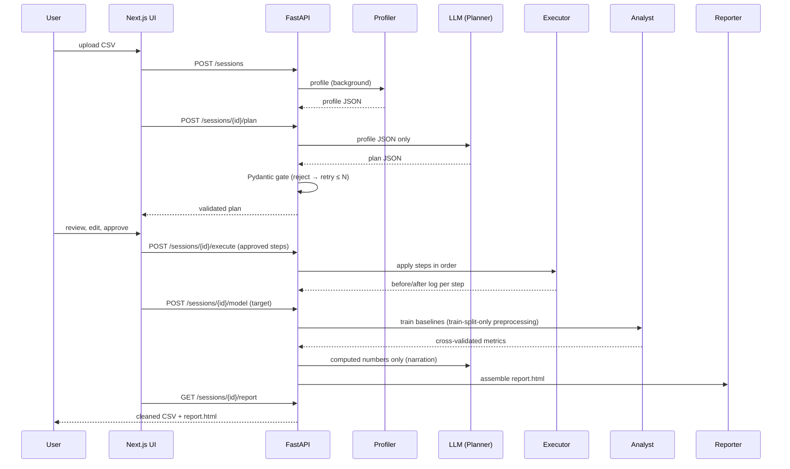

# Architecture — AI Data Science Agent

> **Status:** Draft v0.1 · **Traces to:** PRD §5, §6, §8 · **Stack details:** see `tech-stack.md`

## 1. System Context



One backend process (MVP, local demo): FastAPI app, background task runner, SQLite
database, and a filesystem artifact store. The only external service is the Google Gemini API.

## 2. Backend Components



### Component Responsibilities

| Component | Type | Responsibility | Reads | Writes | Failure mode |
|---|---|---|---|---|---|
| **Routers** | code | HTTP boundary; request validation; auth-free (local MVP) | — | session rows | 4xx on bad input |
| **Orchestrator** | code | Session state machine; dispatches stages as background tasks; progress tracking | all | session state | stage error recorded; session stays in last good state |
| **Profiler Agent** | deterministic | Type inference, nulls, dupes, IQR outliers, compact profile JSON | upload CSV | profile JSON, DB | fails fast on unreadable CSV |
| **Planner Agent** | LLM | Cleaning plan with rationale per step | profile JSON | plan JSON | invalid output → bounded retries → surfaced error |
| **Schema Gate** | code | Pydantic validation; whitelist enforcement; re-prompt feedback | plan JSON | validated plan | rejects unknown ops/params |
| **Executor Agent** | deterministic | Applies approved steps in order; before/after log per step | upload CSV + approved plan | cleaned CSV, execution log | step failure aborts with log preserved |
| **Visualizer Agent** | deterministic | Auto-charts (capped count) | cleaned CSV | chart PNGs | skips chart types with no eligible columns |
| **Analyst Agent** | deterministic | Problem-type detection; 2–3 baselines; cross-validated comparison | cleaned CSV + target | model runs, metrics | rejects invalid target before training |
| **Narrator Agent** | LLM | Plain-language findings + model recommendation | computed numbers + profile summary | narration text | falls back to template summary |
| **Reporter Agent** | deterministic | Assembles `report.html` from artifacts + narration | all artifacts | report.html | missing artifact → report lists the gap |

**Determinism boundary:** everything below the routers is deterministic except the
Planner and Narrator, which are the only components allowed to call the LLM — and both
are fenced by gates (see `design.md` §4–§5).

## 3. API Contracts (PRD §8)

| Method & Path | Purpose | Request | Response |
|---|---|---|---|
| `POST /sessions` | Upload CSV, start profiling | multipart file | `201` session ID + status |
| `GET /sessions/{id}/profile` | Fetch the profile | — | profile JSON |
| `POST /sessions/{id}/plan` | Submit the cleaning plan (M2: manual, Gate-validated; M3 adds LLM generation) | plan JSON (`schema: v1`) | plan JSON (steps + rationales) |
| `GET /sessions/{id}/plan` | Fetch the stored plan (review UI input) | — | plan JSON |
| `POST /sessions/{id}/execute` | Run the **approved** plan; server re-validates via the Gate | approved/edited steps | `202` + poll status; execution log artifact |
| `POST /sessions/{id}/model` | Run baselines for a target | `{ "target": "column" }` | problem type + model comparison |
| `GET /sessions/{id}/report` | Fetch/download the report | — | `report.html` (or 404 until ready) |
| `GET /sessions/{id}` | **(added)** session status for progress polling | — | state + per-stage progress | 

The status endpoint is an addition to the PRD's suggested set: background execution
(PRD §8, *Job handling*) needs a polling surface for the UI.

### Example payloads

```jsonc
// GET /sessions/{id}/profile  (abridged)
{
  "session_id": "7f3a…",
  "n_rows": 891, "n_columns": 12, "duplicate_rows": 0,
  "columns": [
    { "name": "Age", "type": "numeric", "nulls": 177, "null_pct": 19.9,
      "unique": 88, "outliers_iqr": 11,
      "stats": { "min": 0.42, "max": 80.0, "mean": 29.7, "std": 14.5 } }
  ]
}
```

```jsonc
// POST /sessions/{id}/plan  (response, abridged)
{
  "steps": [
    { "id": 1, "op": "impute", "column": "Age",
      "params": { "strategy": "median" },
      "rationale": "Age is 19.9% missing; median is robust to the 11 IQR outliers." },
    { "id": 2, "op": "drop_duplicates", "column": null,
      "params": {}, "rationale": "No duplicates found; step disabled." }
  ]
}
```

## 4. Data Flow & Audit Trail



**Audit trail:** every plan step is persisted with its op, column, params, rationale,
approval status, and before/after counts from execution. Combined with the immutable
original upload, any report can be reproduced and every change explained (PRD §3, §7).

## 5. Storage Layout

```
storage/
└── sessions/{session_id}/
    ├── upload.csv              # original, never modified
    ├── profile.json
    ├── plan.json               # as generated + as approved
    ├── execution_log.json
    ├── cleaned_<name>.csv      # deliverable 1
    ├── charts/*.png            # capped
    ├── model_runs.json
    ├── narration.json
    └── report.html             # deliverable 2
```

SQLite holds session metadata and state; the filesystem holds artifacts. Both are
behind thin interfaces so a hosted deployment can swap SQLite→Postgres and filesystem→
object storage without touching pipeline code (PRD §8).

## 6. Deployment View (MVP)

- **Local demo:** single FastAPI process serving the API + built Next.js static export;
  SQLite + local `storage/` directory; `GEMINI_API_KEY` from `.env`
- **Background jobs:** FastAPI `BackgroundTasks` (MVP); a queue (e.g., Celery/RQ/arq)
  is the upgrade path if stages need isolation or horizontal scaling
- **Hosting later:** frontend → Vercel; backend → any container host; storage → S3-style
  object store; DB → Postgres. Auth becomes required outside localhost (out of MVP scope).

## 7. Observability

Structured logs (JSON lines) per pipeline stage and per LLM call:

| Event | Key fields |
|---|---|
| `session.created` | session_id, filename, size, rows |
| `profile.completed` | session_id, duration_ms, n_columns, issues found |
| `plan.requested` / `plan.validated` / `plan.rejected` | session_id, attempt, error (if any) |
| `llm.call` | stage (planner/narrator), model, prompt_tokens, duration_ms — **no data content logged** |
| `execute.step` | session_id, step_id, op, rows_before/after, nulls_before/after |
| `model.completed` | session_id, target, problem_type, best_model, cv_score |
| `report.generated` | session_id, duration_ms |

Log events map to the PRD §7 *Observability* requirement and the §9 metrics
(schema validity rate, time to report).
