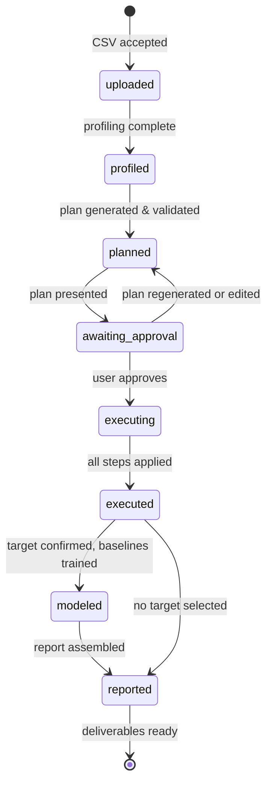

# System Guide — AI Data Science Agent

> **Status:** Draft v0.1 · **Traces to:** PRD §1–§7, §11 · **Audience:** users, operators, new contributors

## 1. What This System Does

The AI Data Science Agent automates the repetitive "first mile" of a data science workflow.
You upload a CSV, and the system:

1. **Profiles** it (types, nulls, duplicates, outliers, cardinality, basic stats)
2. **Proposes a cleaning plan** (LLM-generated, structured, with a reason for every step)
3. **Waits for your approval** — you can toggle or edit any step
4. **Executes** the approved plan deterministically with pandas
5. **Generates charts** (distributions, correlations, missingness, category counts)
6. **Trains baseline ML models** (2–3 models, cross-validated, honestly compared)
7. **Produces a report** and a cleaned dataset you can download

**Who it is for:** students and junior data scientists who want a fast, guided starting
point on an unfamiliar dataset; secondarily analysts and developers who need a quick look
at a CSV.

**What it is not:** it is not AutoML, it does not deploy production models, it does not
touch databases or streaming data, and it does not handle anything beyond CSV in v1
(PRD §3, Non-Goals).

## 2. The Golden Rule

> **The LLM plans and narrates; all data work is deterministic.**

The LLM never sees your raw rows and never writes executable code. It receives only an
aggregate **profile** (column statistics) and returns a structured JSON plan that is
validated against a strict whitelist of operations. Everything that actually modifies
data is pandas/scikit-learn code that we wrote, reviewed, and test.

This gives three guarantees (PRD §7):

| Guarantee | How it is enforced |
|---|---|
| **Safety** | No arbitrary code execution from LLM output; strict schema validation |
| **Privacy** | Only aggregate profile statistics leave the system; uploads deleted after a retention window |
| **Reproducibility** | The same data + the same approved plan always produce byte-identical outputs |

## 3. The Pipeline, Stage by Stage (PRD §5)

| # | Stage | What happens | What you see / do |
|---|---|---|---|
| 1 | **Upload** | CSV ingested with encoding detection and delimiter sniffing; size/row limits enforced; a session ID is created | Pick a file; see a clear error if limits are exceeded |
| 2 | **Profile** | Deterministic scan: column types, null counts/%, duplicate rows, unique counts, top values, IQR outliers | Column-by-column profile summary |
| 3 | **Plan** | LLM receives the **profile JSON only** and returns a structured cleaning plan; every step carries a rationale | The proposed plan (steps + reasons) |
| 4 | **Review** | — | Toggle steps on/off, edit parameters, **explicitly approve** |
| 5 | **Execute** | pandas applies the approved steps in order; before/after counts logged per step | Progress; an audit log of changes |
| 6 | **Visualize** | Auto-generated charts: histograms, box plots, correlation heatmap, missing-value map, top categories | Chart gallery (capped for readability) |
| 7 | **Model** | You confirm the target column; problem type detected by rules; 2–3 baselines trained with cross-validation | Model comparison table + plain-language explanation |
| 8 | **Report** | LLM narrates findings **from computed numbers only**; system assembles the final HTML report | Two downloads: cleaned CSV + report |

## 4. Session Lifecycle

Every upload creates a **session** with an ID. A session moves through a fixed state
machine; each stage's artifacts (profile, plan, execution log, charts, models, report)
are stored and associated with the session.

Failure at any stage keeps the session in its last good state with a recorded error; you
can retry the failed stage (e.g., re-generate the plan after an LLM validation failure)
without re-uploading.

**Retention:** uploaded files and generated artifacts are deleted after a retention
window (see §7, Limits). The original upload is **never modified** — cleaning always
writes new artifacts.

## 5. Deliverables (PRD §6.9)

After processing, the results page offers two required downloads:

1. **Cleaned dataset** — `cleaned_<original_name>.csv`
   The data after all approved cleaning steps. Original column names and order are
   preserved unless you approved a rename or drop. The original upload is untouched.
2. **Process report** — `report.html`
   Documents the whole run, in order: dataset snapshot (before/after), issues found,
   the cleaning plan and each action with its approval status and before/after counts,
   a before-vs-after comparison, charts, the ML analysis, and the narrated summary.

Optional extras (do not change the core flow): a single `.zip` bundling both files,
the reproducible Python script of executed steps, and the chart PNGs.
*(PDF export is a stretch goal — HTML is the MVP format.)*

## 6. Error Handling

| Situation | Behavior |
|---|---|
| File too large / too many rows | Upload rejected with a clear message stating the limits |
| Malformed CSV (bad encoding, broken rows) | Encoding detection + delimiter sniffing; if still unreadable, the session fails at `uploaded` with a specific reason |
| Empty columns / all-null columns | Reported in the profile; the planner may propose `drop_column`; executor logs the change |
| LLM returns invalid JSON or an unknown operation | Rejected; LLM re-prompted with the validation error, up to a **bounded** number of retries; then surfaced as a plan-generation failure you can retry |
| LLM unreachable | Plan/narration stages fail gracefully; deterministic stages (profile, execute, charts, models) still work |
| Modeling with a bad target (e.g., ID-like, all-unique) | Rejected before training with an explanation |

## 7. Limits & Configuration

| Limit | Default (MVP) | Notes |
|---|---|---|
| Max file size | Configurable (e.g., 25 MB) | Hard reject with message |
| Max rows | Configurable (e.g., 100k) | Chunked reading is a stretch goal |
| Charts per report | Capped (e.g., 12) | Keeps the report readable (PRD §6.6) |
| Baseline models | 2–3 | e.g., logistic/linear regression + random forest |
| LLM plan retries | Bounded (e.g., 3) | Each retry includes the validation error |
| Upload retention | Configurable (e.g., 7 days) | Then deleted (privacy, PRD §7) |

All limits are environment configuration, not hard-coded (see `tech-stack.md`, §Environment).

## 8. Privacy & Data Handling

- Only the **aggregate profile** (statistics, top values) is sent to the LLM — never raw rows
- Narration prompts contain **computed numbers only**
- Uploads and artifacts are deleted after the retention window; a clear user notice
  states what is sent to the LLM (PRD §10, *Sensitive data*)

## 9. Success Criteria (PRD §9)

The system is working well when:

- **Plan quality:** most generated plans are judged sensible on test datasets (Titanic, Housing, Telco Churn)
- **Schema validity rate:** most LLM responses pass validation on the first attempt
- **Time to report:** median upload → finished report is minutes, not hours
- **Approval rate:** most plan steps are accepted without edits
- **Reproducibility:** repeated runs of the same approved plan produce identical outputs

## 10. FAQ

**Can the LLM see my data?** No — only column-level statistics from the profile.

**Can I undo a cleaning step?** The execution log records every step with before/after
counts, and the original file is never modified. Per-step undo/redo is a stretch feature;
today you re-run with an edited plan.

**Can I use it for NLP or images?** Not in v1 — tabular CSVs only (PRD §3).

**Does it pick the best model for me?** It trains 2–3 honest baselines with
cross-validation and explains the comparison in plain language. It does not tune or
deploy production models.
